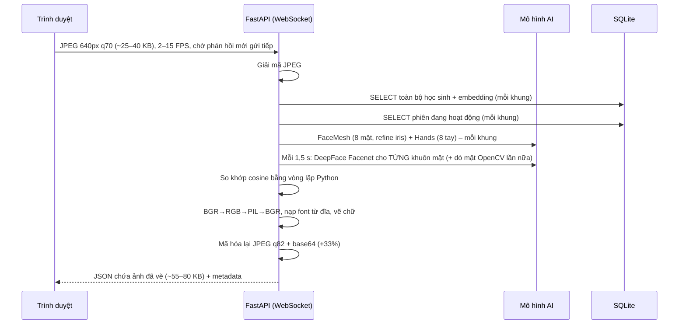
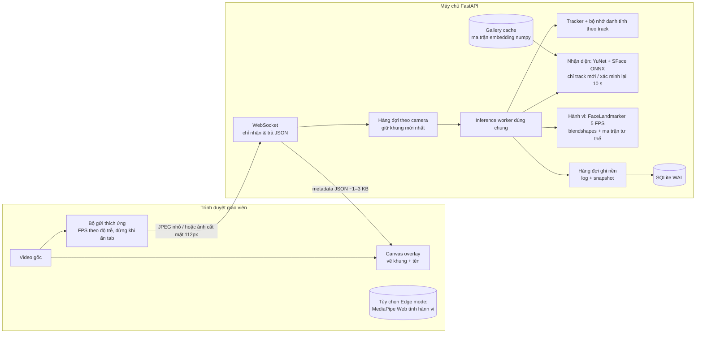

# Đề xuất nâng cấp kiến trúc: tối ưu hiệu suất & giảm tải (v2.0)

> Phạm vi: rà soát đường xử lý mỗi khung hình của v1.3.0 và đề xuất lộ trình giúp hệ thống chạy được trên **máy tính phổ thông của trường/xã (CPU, không GPU, 8 GB RAM)**, nhiều lớp cùng lúc, băng thông thấp.
> Các con số trong tài liệu là **ước tính từ phân tích mã nguồn**, cần xác nhận bằng bước đo ở mục 6 trước khi triển khai.

---

## 1. Hiện trạng: một khung hình đi qua những gì?

### Các điểm nghẽn chính

| # | Điểm nghẽn | Vị trí | Mức độ |
|---|-----------|--------|--------|
| A | **Gửi ngược lại cả khung hình đã vẽ**, trong khi trình duyệt đã có video gốc. Tốn mã hóa JPEG, chuyển PIL 2 lần, base64 và gấp đôi băng thông | `stream_processor.process`, `draw_overlay` | Rất cao |
| B | **TensorFlow + DeepFace (Facenet)**: cài đặt ~1–2 GB, RAM ~1 GB, khởi động chậm, hay xung đột phiên bản (`tensorflow`, `tf-keras`, `protobuf`) | `face_engine.DeepFaceEmbeddingProvider` | Rất cao |
| C | Nhận diện lại **tất cả** khuôn mặt mỗi 1,5 s, kể cả người đã biết danh tính và không rời khung hình. Lớp 40 học sinh ≈ 27 lần trích xuất/giây | `recognize_if_due` | Cao |
| D | `DeepFace.represent(detector_backend="opencv")` **dò mặt lần nữa** trên ảnh đã cắt | `face_engine.py:70` | Trung bình |
| E | FaceMesh `refine_landmarks=True` (thêm mống mắt, không dùng tới) + Hands chạy **mỗi khung** dù các luật hành vi cần 2–3 giây liên tục | `behavior_engine.py:300–306` | Cao |
| F | Truy vấn CSDL toàn bộ học sinh + phiên **mỗi khung**, giải mã JSON embedding, cosine bằng Python thuần | `stream_processor.py:122–124` | Trung bình (tăng theo sĩ số) |
| G | **Mỗi kết nối WebSocket tạo bản sao mô hình riêng** (FaceDetection + FaceMesh + Hands). Mỗi lần đăng ký học sinh cũng tạo detector mới | `main.py:587`, `main.py:262` | Cao khi nhiều lớp |
| H | Tốc độ gửi cố định (`setInterval`), không thích ứng với độ trễ; vẫn gửi khi tab bị ẩn | `app.js restartCameraTimer` | Trung bình |
| I | Ghi snapshot/log đồng bộ trong luồng xử lý khung | `_save_alerts` | Thấp |
| J | Dùng API cũ `mp.solutions` (đã ngừng phát triển, bị ghim `mediapipe<=0.10.21`) | `behavior_engine`, `face_engine` | Rủi ro bảo trì |

**Ước tính v1.3** (CPU 4 nhân, 1 lớp ~30 học sinh): độ trễ mỗi khung 120–250 ms → thực tế chỉ đạt 4–8 FPS dù chọn 15 FPS; băng thông xuống ~0,5–0,8 MB/s; RAM tiến trình 1,5–2,5 GB; mỗi lớp thêm cộng thêm một bộ mô hình.

---

## 2. Nguyên tắc thiết kế mới

1. **Không gửi ảnh ngược về trình duyệt** – máy chủ chỉ trả metadata (khung, tên, cảnh báo); trình duyệt tự vẽ.
2. **Việc nặng chạy thưa, việc nhẹ chạy dày** – nhận diện danh tính chỉ khi có *track mới* hoặc định kỳ dài; hành vi chạy 5 FPS là đủ cho luật 2–3 giây.
3. **Một bộ mô hình dùng chung**, hàng đợi “khung mới nhất thắng”, tự bỏ khung khi quá tải.
4. **Bỏ TensorFlow**, dùng mô hình ONNX nhỏ chạy bằng OpenCV DNN/ONNX Runtime trên CPU.
5. **Dữ liệu nóng nằm trong RAM** (embedding dạng ma trận numpy, phiên đang hoạt động); CSDL chỉ ghi khi trạng thái thay đổi.
6. **Đo trước, tối ưu sau** – mỗi giai đoạn có số liệu p50/p95.

---

## 3. Kiến trúc đích

### 3.1 Thay bộ nhận diện: DeepFace/TensorFlow → YuNet + SFace (OpenCV)

- `cv2.FaceDetectorYN` (YuNet, ~0,2 MB) và `cv2.FaceRecognizerSF` (SFace, ~37 MB ONNX) **đã có sẵn trong `opencv-contrib-python`** đang dùng → bỏ hẳn `deepface`, `tensorflow`, `tf-keras`.
- YuNet trả sẵn 5 điểm mốc → `alignCrop` căn chỉnh khuôn mặt chuẩn, độ chính xác ổn định hơn cắt khung thô như hiện tại.
- So khớp: `embeddings_matrix @ query` một phép nhân ma trận cho cả lớp thay cho vòng lặp Python.
- **Chuyển đổi dữ liệu**: embedding Facenet và SFace không tương thích. Ảnh đại diện đã được lưu mã hóa, nên có thể **tính lại embedding tự động** bằng một lệnh `python -m src.reembed` mà không cần học sinh đăng ký lại. Thêm cột `students.embedding_model` để biết mỗi vector thuộc mô hình nào.
- Phương án dự phòng nếu cần độ chính xác cao hơn: ArcFace/MobileFaceNet ONNX qua `onnxruntime` (kiểm tra kỹ giấy phép sử dụng của từng mô hình trước khi triển khai cho cơ quan nhà nước).

### 3.2 Nhận diện theo track (“nhớ danh tính”)

| Tình huống | v1.3 | Đề xuất |
|---|---|---|
| Khuôn mặt mới xuất hiện | Chờ chu kỳ 1,5 s | Nhận diện ngay ở khung kế tiếp |
| Track đã có danh tính tin cậy | Nhận diện lại mỗi 1,5 s | Xác minh lại mỗi 10 s (hoặc khi khung thay đổi lớn) |
| Track chưa nhận ra | Mỗi 1,5 s | Thử lại sau 2 s, tối đa N lần rồi giãn ra |
| Điểm danh | 5 lần liên tiếp × 1,5 s ≈ 7,5 s | 3 lần khớp trong cửa sổ 5 s, có thể bỏ sót 1 lần |

Với lớp 30 học sinh ngồi yên, số lần trích xuất embedding giảm từ ~20/giây xuống ~3/giây (ước tính).

### 3.3 Phân tích hành vi nhẹ hơn

- Chuyển sang **MediaPipe Tasks `FaceLandmarker`** (chế độ VIDEO): trả **blendshapes** (`eyeBlinkLeft/Right`, `jawOpen`) và **ma trận biến đổi khuôn mặt** → bỏ được EAR/MAR tự tính và `solvePnP`; một mô hình làm được cả ngủ gục, nói chuyện, quay cóp.
- Tắt `refine_landmarks` nếu còn dùng API cũ (các chỉ số mắt/miệng hiện dùng không cần mống mắt).
- Chạy hành vi ở **5 FPS** độc lập với tốc độ hiển thị; **Hands chỉ chạy 2–3 FPS** và chỉ trong vùng mở rộng quanh khuôn mặt.
- Giới hạn `max_num_faces` theo sĩ số thực tế của phiên.

### 3.4 Luồng & tài nguyên phía máy chủ

- **Một inference worker dùng chung** (một bộ mô hình) phục vụ mọi camera; mỗi camera có hàng đợi dung lượng 1, khung cũ bị thay khi khung mới tới. Giới hạn số camera đồng thời bằng cấu hình.
- Bộ đăng ký học sinh dùng lại detector của worker thay vì tạo mới mỗi lần.
- `GalleryCache`: nạp embedding một lần, đánh số phiên bản, làm mới khi đăng ký/cập nhật/xóa học sinh. `ActiveSessionCache` tương tự.
- Hàng đợi ghi nền cho snapshot + `behavior_logs`; SQLite bật `PRAGMA journal_mode=WAL`, `synchronous=NORMAL`.
- Giữ cơ chế “chờ phản hồi mới gửi tiếp” (backpressure) – đây là điểm tốt của v1.3.

### 3.5 Phía trình duyệt

- Vẽ overlay trên `<canvas>` phủ lên `<video>` từ metadata; video hiển thị mượt 30 FPS bất kể tốc độ phân tích.
- Bộ gửi thích ứng: đo độ trễ khứ hồi, tự hạ độ phân giải/FPS khi chậm; dừng gửi khi `document.hidden`.
- Dùng `createImageBitmap`/`OffscreenCanvas` để nén ảnh ngoài luồng giao diện nếu trình duyệt hỗ trợ.

### 3.6 Edge mode (tùy chọn, giai đoạn 3)

Chạy **MediaPipe Tasks for Web** ngay trong trình duyệt: tính hành vi và cắt khuôn mặt tại chỗ, chỉ gửi **ảnh mặt 112×112 (~3–5 KB)** khi cần nhận diện và **sự kiện cảnh báo** kèm snapshot.

- Ưu: tải máy chủ giảm mạnh, một máy chủ nhỏ phục vụ được nhiều lớp; băng thông rất thấp; khung hình đầy đủ không rời phòng học (tốt cho bảo vệ dữ liệu cá nhân).
- Nhược: cần máy giáo viên đủ mạnh (WebGL/WASM); hai bộ mã hành vi (Python cho chế độ máy chủ, JS cho edge). Giữ chế độ máy chủ cho máy cũ, chọn qua Cài đặt.

---

## 4. Lộ trình đề xuất

| Giai đoạn | Nội dung | Công sức | Rủi ro | Tác động ước tính |
|---|---|---|---|---|
| **0. Đo lường** | Gắn thời gian từng bước vào khung trả về, script benchmark từ video mẫu | 0,5 ngày | Thấp | Có số liệu chuẩn để so sánh |
| **1. Tối ưu nhanh** | (A) bỏ ảnh trả về, vẽ canvas · (D) `detector_backend="skip"` · (E) tắt refine, hành vi 5 FPS, Hands thưa · (F) cache gallery/phiên + numpy · (H) gửi thích ứng · (G) dùng chung mô hình đăng ký | 2–3 ngày | Thấp | Băng thông xuống giảm ~95%, CPU máy chủ giảm ~40–60%, FPS thực tăng ~2× |
| **2. Thay mô hình** | (B) YuNet + SFace, script tính lại embedding, (C) nhận diện theo track, (J) FaceLandmarker Tasks + blendshapes | 4–6 ngày | Trung bình (cần nghiệm thu lại độ chính xác, ngưỡng) | Bỏ ~1–2 GB phụ thuộc, RAM còn ~300–500 MB, khởi động vài giây |
| **3. Mở rộng** | Inference worker dùng chung + hàng đợi, ghi nền, WAL, giới hạn camera; Edge mode tùy chọn | 5–8 ngày | Trung bình | Nhiều lớp trên một máy chủ; Edge mode giảm tải máy chủ thêm nhiều lần |

Thứ tự này cho phép dừng ở bất kỳ giai đoạn nào mà hệ thống vẫn chạy được; giai đoạn 1 không đổi dữ liệu hay mô hình.

---

## 5. Mục tiêu đo được (KPI)

| Chỉ số | v1.3 (ước tính) | Mục tiêu v2.0 |
|---|---|---|
| Độ trễ xử lý khung p95 | 150–250 ms | < 60 ms |
| FPS phân tích thực tế (1 lớp) | 4–8 | ≥ 10 (hành vi 5) |
| Băng thông máy chủ → trình duyệt | 0,5–0,8 MB/s | < 20 KB/s |
| RAM tiến trình | 1,5–2,5 GB | < 600 MB |
| Dung lượng cài đặt Python | > 2 GB | < 400 MB |
| Thời gian từ khởi động đến khung đầu | 10–30 s | < 5 s |
| Số lớp đồng thời / máy CPU 4 nhân | 1 | 3–4 (chế độ máy chủ), 10+ (edge) |
| Thời gian điểm danh một học sinh | ~7,5 s | ~3–5 s |
| Độ chính xác điểm danh | — | Không thấp hơn v1.3 trên bộ ảnh nghiệm thu |

---

## 6. Cách đo trước khi làm

1. Thêm trường `timings` (ms) cho từng bước: decode, db, facemesh, hands, recognize, overlay, encode – bật bằng `FACE_APP_PROFILE=true`.
2. Script `python -m src.benchmark --video lop_mau.mp4` chạy pipeline không cần trình duyệt, xuất p50/p95, CPU, RAM.
3. Ghi lại cấu hình máy thực tế ở trường/xã (CPU, RAM, mạng LAN/Wi-Fi) để chọn chế độ máy chủ hay edge.
4. Bộ nghiệm thu độ chính xác: 20–30 học sinh × 3 điều kiện ánh sáng; so tỷ lệ điểm danh đúng/sai giữa Facenet và SFace trước khi chuyển hẳn.

---

## 7. Trạng thái triển khai

### Giai đoạn 0 – Đo lường ✅
- `FACE_APP_PROFILE=true`: mỗi khung trả về `timings` (ms) cho các bước `decode`, `cache`, `behavior`, `recognize`, `attendance`, `alerts`, `overlay`; luôn có `timings.total`.
- `python -m src.benchmark --video lop_mau.mp4 --session [--data-dir src/data] [--overlay]`: chạy pipeline không cần trình duyệt trên **bản sao** dữ liệu, in FPS, KB tải lên/xuống mỗi khung và p50/p95 từng bước. Chạy một lần với `--overlay` (chế độ cũ) và một lần không có để so sánh.

### Giai đoạn 1 – Tối ưu nhanh ✅

| Mục | Thay đổi | Tệp |
|---|---|---|
| A | Máy chủ không còn trả ảnh; trình duyệt vẽ khung/tên/cảnh báo trên `<canvas>` phủ video (nhãn cảnh báo giữ 3 giây). Chế độ cũ: thêm `?overlay=server` vào địa chỉ trang | `stream_processor.py`, `app.js`, `index.html` |
| D | DeepFace dùng `detector_backend="skip"` (`FACE_APP_EMBED_DETECTOR`) | `face_engine.py` |
| E | FaceMesh tắt `refine_landmarks`; hành vi chạy `FACE_APP_BEHAVIOR_FPS` (mặc định 8), Hands `FACE_APP_HAND_FPS` (mặc định 3); số mặt tối đa `FACE_APP_MAX_FACES` | `behavior_engine.py` |
| F | `VersionedCache` giữ danh sách học sinh (dạng `Gallery` – ma trận numpy) và phiên đang hoạt động trong RAM, làm mới khi dữ liệu đổi hoặc sau 5 giây; so khớp bằng phép nhân ma trận | `cache.py`, `face_engine.py`, `stream_processor.py` |
| G | Một bộ mô hình dùng chung (có khóa) cho đăng ký và `/api/health` | `main.py` |
| H | Trình duyệt đo độ trễ khứ hồi, tự hạ độ phân giải 640 → 480 → 360 khi chậm, dừng gửi khi tab ẩn, tự gỡ kẹt nếu mất phản hồi 5 giây; hiển thị độ trễ trên thanh trạng thái | `app.js` |
| + | SQLite bật WAL; font overlay nạp một lần | `database.py`, `stream_processor.py` |

**Lưu ý khi nâng cấp:** đổi sang `skip` làm thay đổi vector đặc trưng. Khi khởi động, máy chủ tự **tính lại embedding từ ảnh đại diện đã lưu** cho học sinh có `embedding_model` cũ (cũng chạy tay được: `python -m src.reembed`). Học sinh đăng ký **không có ảnh** thì không tính lại được – hãy cập nhật ảnh cho các em này. Muốn giữ hành vi cũ: `FACE_APP_EMBED_DETECTOR=opencv`.

### Giai đoạn 2–3 – Chưa thực hiện
Chờ số liệu đo thực tế từ giai đoạn 0 trên máy của trường/xã.

## 8. Những gì giữ nguyên

- FastAPI + WebSocket, SQLite, xác thực cookie, lưu ảnh mã hóa, chính sách lưu 30 ngày.
- Toàn bộ nghiệp vụ v1.3 (giờ vào, đi muộn, điểm danh thủ công, lịch sử, CSV).
- API REST hiện có; WebSocket thêm `frame_size`, `timings`; trường `image` chỉ còn khi dùng `?overlay=server`.
