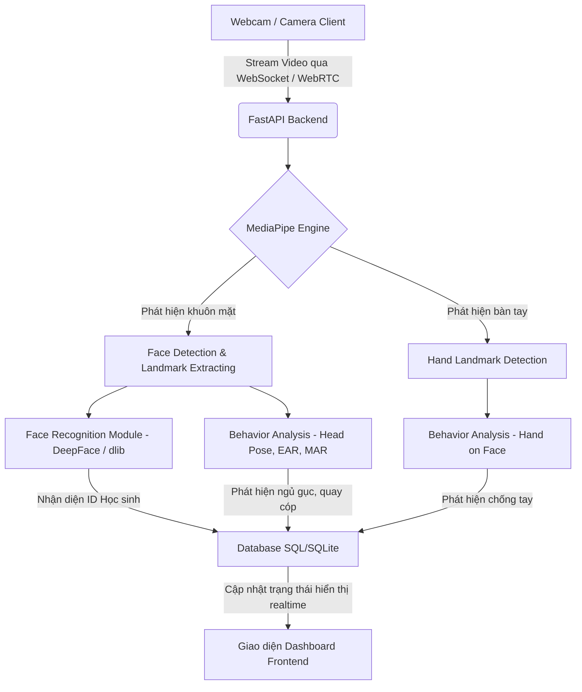

# Kế hoạch Triển khai Hệ thống Nhận diện Khuôn mặt & Giám sát Lớp học (Face Recognition & Classroom Monitoring)

Hệ thống quản lý lớp học thông minh sử dụng camera (webcam) để điểm danh, nhận diện học sinh, chọn ngẫu nhiên học sinh trả bài (quản lý theo phiên) và tự động phát hiện các hành vi bất thường trong lớp học (ngủ gục, chống tay, quay cóp, trao đổi).

---

## 1. Kiến trúc Hệ thống (System Architecture)

Hệ thống được thiết kế dưới dạng **Web Application** chạy trên nền tảng Python ở Backend và giao diện Web hiện đại ở Frontend.



### Công nghệ sử dụng:
*   **Backend**: Python (FastAPI), OpenCV, MediaPipe, SQLite (SQLAlchemy).
*   **Frontend**: HTML5, CSS (Vanilla CSS với phong cách Glassmorphism, Dark Mode, Responsive Grid), Javascript (WebSocket Client, Chart.js để vẽ biểu đồ thống kê).
*   **Thư viện chính**:
    *   `mediapipe`: Trích xuất Face Mesh (468+ điểm mốc khuôn mặt) và Hand Landmarks (21 điểm mốc bàn tay).
    *   `face_recognition` hoặc `DeepFace`: Trích xuất đặc trưng khuôn mặt (128-D vector) để so khớp danh tính học sinh.
    *   `numpy` & `scipy`: Xử lý hình học không gian, tính toán khoảng cách và các chỉ số hành vi.

---

## 2. Thiết kế Cơ sở Dữ liệu (Database Design)

Sử dụng SQLite để lưu trữ thông tin nội bộ đơn giản và hiệu quả.

### Bảng `students` (Danh sách học sinh)
| Trường | Kiểu dữ liệu | Mô tả |
| :--- | :--- | :--- |
| `id` | INTEGER (PK) | Khóa chính |
| `student_code` | VARCHAR(20) | Mã số học sinh (duy nhất) |
| `fullname` | VARCHAR(100) | Họ và tên học sinh |
| `embedding` | TEXT / BLOB | Vector đặc trưng khuôn mặt dạng JSON string hoặc nhị phân |
| `avatar_path` | VARCHAR(255) | Đường dẫn đến ảnh đại diện |

### Bảng `sessions` (Phiên học / Tiết học)
| Trường | Kiểu dữ liệu | Mô tả |
| :--- | :--- | :--- |
| `id` | INTEGER (PK) | Khóa chính |
| `created_at` | TIMESTAMP | Thời gian bắt đầu phiên |
| `status` | VARCHAR(10) | Trạng thái phiên (`ACTIVE`, `FINISHED`) |

### Bảng `session_students` (Trạng thái gọi tên trong phiên)
| Trường | Kiểu dữ liệu | Mô tả |
| :--- | :--- | :--- |
| `id` | INTEGER (PK) | Khóa chính |
| `session_id` | INTEGER (FK) | Liên kết với bảng `sessions` |
| `student_id` | INTEGER (FK) | Liên kết với bảng `students` |
| `is_present` | BOOLEAN | Xác nhận có mặt trong lớp học |
| `is_called` | BOOLEAN | Đã được gọi lên trả bài hay chưa |
| `called_at` | TIMESTAMP | Thời điểm bị gọi tên (nullable) |

### Bảng `behavior_logs` (Nhật ký hành vi)
| Trường | Kiểu dữ liệu | Mô tả |
| :--- | :--- | :--- |
| `id` | INTEGER (PK) | Khóa chính |
| `session_id` | INTEGER (FK) | Liên kết với bảng `sessions` |
| `student_id` | INTEGER (FK) | Liên kết với bảng `students` (nullable nếu không nhận diện được) |
| `behavior_type`| VARCHAR(20) | Loại hành vi (`SLEEPING`, `HAND_ON_FACE`, `CHEATING`, `TALKING`) |
| `timestamp` | TIMESTAMP | Thời điểm phát hiện hành vi |
| `snapshot_path`| VARCHAR(255) | Đường dẫn lưu ảnh chụp làm bằng chứng |

---

## 3. Thuật toán Phát hiện Hành vi (Behavior Detection Logic)

Sử dụng **MediaPipe Face Mesh** (468 điểm mốc) và **MediaPipe Hands** (21 điểm mốc) để phân tích hành vi mà không cần chạy các mô hình Deep Learning quá nặng.

### 3.1. Phát hiện Ngủ gục (Sleeping)
*   **Phương pháp**: Tính toán tỉ lệ đóng mở mắt **EAR (Eye Aspect Ratio)** dựa trên các điểm mốc mắt của MediaPipe.
    $$EAR = \frac{||p_2 - p_6|| + ||p_3 - p_5||}{2 \times ||p_1 - p_4||}$$
    *(Trong đó $p_1 \dots p_6$ là tọa độ các điểm mốc trên mắt trái/phải).*
*   **Logic**: 
    1. Nếu $EAR < Threshold\_Eye$ (thường là 0.2) liên tục trong $N$ giây (ví dụ: 3 giây), hệ thống ghi nhận trạng thái **Nhắm mắt**.
    2. Kết hợp với **Độ nghiêng của đầu** (Pitch angle): Nếu góc Pitch nghiêng xuống dưới quá mức cho phép cùng lúc nhắm mắt, hệ thống xác nhận học sinh đang **Ngủ gục**.

### 3.2. Phát hiện Chống tay (Hand on Face)
*   **Phương pháp**: Sử dụng đồng thời **MediaPipe Face Mesh** và **MediaPipe Hand Landmarker**.
*   **Logic**:
    1. Lấy tọa độ vùng biên khuôn mặt (Face Boundary) hoặc các mốc ở cằm, má từ Face Mesh.
    2. Lấy tọa độ 21 điểm mốc của bàn tay (đặc biệt là các đầu ngón tay và lòng bàn tay).
    3. Tính toán khoảng cách Euclidean ngắn nhất giữa các điểm mốc tay và các điểm mốc mặt.
    4. Nếu khoảng cách giữa bất kỳ điểm mốc tay nào tới vùng mặt nhỏ hơn một khoảng $Threshold\_Hand$ (tương đối theo kích thước khuôn mặt) và kéo dài hơn 2 giây $\rightarrow$ Hệ thống cảnh báo hành vi **Chống tay lên cằm/má**.

### 3.3. Phát hiện Quay cóp / Nhìn xung quanh (Cheating / Looking Away)
*   **Phương pháp**: Ước lượng tư thế đầu **Head Pose Estimation** bằng thuật toán PnP (Perspective-n-Point) của OpenCV.
*   **Logic**:
    1. Chọn một tập hợp các điểm mốc 3D chính trên mặt (đầu mũi, cằm, góc mắt trái/phải, góc miệng trái/phải).
    2. So khớp các điểm mốc này với mô hình khuôn mặt 3D chuẩn (Generic 3D Face Model) để giải phương trình PnP, tìm ra ma trận quay (Rotation Matrix) và dịch chuyển.
    3. Tính ra các góc Euler: **Pitch** (ngẩng/cúi), **Yaw** (quay trái/phải), **Roll** (nghiêng trái/phải).
    4. Nếu góc **Yaw** lệch quá $\pm 30^\circ$ (quay đầu sang trái/phải) hoặc góc **Pitch** cúi xuống quá thấp (nhìn xuống gầm bàn) liên tục trong $T$ giây $\rightarrow$ Xác nhận hành vi **Quay cóp / Nhìn xung quanh**.

### 3.4. Phát hiện Trao đổi / Nói chuyện (Talking)
*   **Phương pháp**: Tính toán tỉ lệ mở miệng **MAR (Mouth Aspect Ratio)**.
*   **Logic**:
    1. Tính khoảng cách dọc giữa môi trên và môi dưới chia cho khoảng cách ngang giữa 2 khóe mép.
    2. Nếu giá trị MAR dao động lớn và liên tục đổi trạng thái mở/khép ở tần số nói chuyện thông thường trong khi tư thế đầu đang hướng về phía học sinh khác $\rightarrow$ Cảnh báo **Trao đổi bài**.

---

## 4. Các chức năng Quản lý Học sinh & Phiên học (Student & Session Management)

### 4.1. Chọn ngẫu nhiên học sinh trả bài (Random Student Picker)
1.  **Thiết lập phiên**: Giáo viên bắt đầu một phiên học (Session). Hệ thống sẽ tự động nhận diện tất cả các khuôn mặt hiện diện trong khung hình camera để đánh dấu chuyên cần (`is_present = True`).
2.  **Bộ lọc danh sách gọi**: Khi giáo viên nhấn nút **"Gọi ngẫu nhiên"**, hệ thống sẽ thực hiện truy vấn:
    ```sql
    SELECT * FROM session_students 
    WHERE session_id = :active_session_id 
      AND is_present = True 
      AND is_called = False;
    ```
3.  **Thuật toán lựa chọn**: 
    *   Hệ thống chọn ngẫu nhiên một học sinh từ danh sách trên.
    *   Cập nhật `is_called = True` và thời gian gọi `called_at`.
    *   Nếu danh sách trống (tất cả học sinh có mặt đều đã được gọi), hệ thống sẽ hiển thị thông báo và cung cấp tùy chọn **Reset phiên gọi** (đặt toàn bộ `is_called = False` để bắt đầu vòng mới).
4.  **Hiệu ứng Giao diện**: Hiển thị vòng quay hoặc hiệu ứng xáo trộn tên ngẫu nhiên trước khi dừng lại ở học sinh được chọn để tăng tính tương tác sinh động.

---

## 5. Các bước Triển khai Chi tiết (Step-by-Step Implementation Plan)

### Bước 1: Thiết lập môi trường và cấu trúc thư mục
1.  Khởi tạo môi trường ảo Python: `python -m venv venv`.
2.  Cài đặt các thư viện cần thiết:
    ```bash
    pip install fastapi uvicorn opencv-python mediapipe sqlalchemy jinja2 python-multipart deepface
    ```
3.  **Lưu ý quan trọng**: Toàn bộ mã nguồn của hệ thống (bao gồm mã nguồn Python của backend, cấu hình cơ sở dữ liệu, các thuật toán phân tích, cùng toàn bộ mã nguồn frontend HTML/CSS/JS) đều được đặt tập trung hoàn toàn trong thư mục `src`.
4.  Xây dựng cấu trúc thư mục dự án chuẩn:
    ```text
    ├── src/
    │   ├── database.py       # Cấu hình kết nối SQLite & Sessionmaker
    │   ├── models.py         # Định nghĩa các bảng Database (SQLAlchemy Models)
    │   ├── face_engine.py    # Logic nhận diện khuôn mặt (DeepFace / face_recognition)
    │   ├── behavior_engine.py# Phân tích hành vi (MediaPipe Landmarks, EAR, Head Pose)
    │   ├── main.py           # API FastAPI chính, WebSocket Server quản lý luồng video
    │   ├── static/           # Thư mục chứa tài nguyên tĩnh cho giao diện web
    │   │   ├── css/
    │   │   │   └── style.css # Giao diện Dashboard cao cấp (Glassmorphism & Dark mode)
    │   │   └── js/
    │   │       └── app.js    # Xử lý WebSocket kết nối webcam và hiển thị kết quả
    │   └── templates/
    │       └── index.html    # Giao diện web Dashboard chính cho giáo viên
    ├── docs/
    │   └── implementation-plan.md # Tài liệu kế hoạch triển khai
    └── requirements.txt
    ```

### Bước 2: Xây dựng Cơ sở Dữ liệu & Đăng ký Học sinh
1.  Viết file `database.py` và `models.py` khai báo các bảng.
2.  Xây dựng chức năng đăng ký học sinh mới (`/register` API):
    *   Nhập mã số học sinh, tên.
    *   Chụp ảnh chân dung học sinh từ webcam hoặc upload ảnh.
    *   Sử dụng module `DeepFace.represent()` để trích xuất đặc trưng (128-D vector) và lưu vào bảng `students`.

### Bước 3: Phát triển Core Nhận diện & Phân tích hành vi
1.  **Xây dựng `behavior_engine.py`**:
    *   Tích hợp MediaPipe Face Mesh và Hands.
    *   Viết các hàm tính góc Pitch, Yaw, Roll bằng `cv2.solvePnP`.
    *   Viết hàm tính toán EAR cho mắt và MAR cho miệng.
    *   Viết hàm kiểm tra chồng tay dựa trên khoảng cách giữa các điểm mốc tay và mặt.
2.  **Xây dựng `face_engine.py`**:
    *   Lấy frame từ camera, chạy MediaPipe Face Detection để cắt vùng khuôn mặt (bounding box).
    *   Chạy so khớp khuôn mặt thông qua so sánh khoảng cách Cosine giữa embedding của khuôn mặt hiện tại và cơ sở dữ liệu học sinh (`DeepFace.verify`).

### Bước 4: Xây dựng FastAPI Backend & WebSocket Streaming
1.  Khởi tạo FastAPI app và cấu hình CORS.
2.  Tạo WebSocket endpoint `/ws` để nhận hình ảnh webcam (dưới dạng Base64 hoặc Binary Bytes) từ Frontend gửi lên liên tục.
3.  Tại Backend, xử lý luồng Frame:
    *   Chuyển đổi hình ảnh sang định dạng OpenCV.
    *   Chạy nhận diện danh tính và phân tích hành vi đồng thời (hoặc sử dụng kỹ thuật đa luồng / bất đồng bộ để tránh nghẽn luồng video).
    *   Vẽ các bounding box, landmarks và văn bản cảnh báo trực tiếp lên frame hoặc trả về dữ liệu metadata dạng JSON.
    *   Gửi lại frame đã xử lý và thông tin metadata về Frontend qua WebSocket.

### Bước 5: Thiết kế Giao diện Frontend Premium
1.  **Thiết kế Layout Dashboard**:
    *   Sử dụng cấu trúc hai cột (Trái: Live Stream Video; Phải: Danh sách học sinh lớp học và Bảng điều khiển trả bài).
    *   **Aesthetic**: Giao diện tối (Sleek Dark Mode), nền mờ kính cường lực (Glassmorphism), viền mỏng sáng bóng, và các màu sắc nhấn bắt mắt (Neon blue, Neon Green cho trạng thái bình thường; Amber/Crimson cho các cảnh báo hành vi xấu).
2.  **Chức năng gọi ngẫu nhiên**:
    *   Một Modal nổi bật với hiệu ứng thẻ bài xoay tròn, dừng lại và hiển thị ảnh chân dung học sinh được chọn.
3.  **Thông báo Realtime**:
    *   Một góc màn hình dành riêng cho các thẻ Alert tự động nhảy lên khi phát hiện hành vi ngủ gục, chống tay hoặc quay cóp.

### Bước 6: Tối ưu hiệu năng và Kiểm thử
1.  **Tối ưu tốc độ xử lý**:
    *   Không chạy nhận diện khuôn mặt (Face Recognition) trên mọi frame. Chỉ chạy nhận diện mỗi 1-2 giây một lần để gán ID khuôn mặt, các frame ở giữa sử dụng thuật toán theo dõi khuôn mặt (Object Tracker) hoặc MediaPipe Face Mesh ID để giảm tải CPU.
    *   Sử dụng Web Worker ở Frontend hoặc các tác vụ nền (Background Tasks) ở Backend để ghi log hành vi vào Database.
2.  **Kiểm thử thực tế**:
    *   Thử nghiệm với webcam có độ phân giải từ 720p trở lên.
    *   Kiểm tra độ chính xác của nhận diện khuôn mặt trong điều kiện ánh sáng yếu.
    *   Đánh giá sai số của bộ nhận diện hành vi (giảm thiểu cảnh báo giả đối với chống tay và quay cóp).

---

## 6. Tiêu chuẩn Nghiệp vụ, Code sạch & Bảo mật (Standards, Clean Code & Security)

### 6.1. Tiêu chuẩn Nghiệp vụ & Độ tin cậy (Business & Quality Standards)
*   **Độ tin cậy điểm danh**: Áp dụng cơ chế xác thực khuôn mặt đa hướng. Chỉ đánh dấu có mặt (`is_present = True`) khi hệ thống nhận diện thành công với độ tin cậy (Confidence) tối thiểu là 80% trong 5 frame liên tiếp để tránh nhận diện sai do chuyển động nhòe hoặc ánh sáng yếu.
*   **Tính khách quan và Đối chiếu (Audit Trail)**: Mọi hành vi vi phạm lớp học được ghi nhận đều bắt buộc đi kèm với một ảnh chụp bằng chứng (`snapshot_path`). Điều này hỗ trợ giáo viên và học sinh dễ dàng đối chiếu trực quan khi có khiếu nại hoặc tranh cãi, đảm bảo tính công bằng của hệ thống.
*   **Hiệu năng Real-time**: Đảm bảo luồng xử lý video (framerate) tối thiểu đạt 15-20 FPS ở client bằng cách phân tách luồng nhận diện khuôn mặt nặng (chạy định kỳ mỗi 1.5 giây) và luồng phân tích MediaPipe Landmark nhẹ (chạy trên từng frame).

### 6.2. Tiêu chuẩn Code sạch Quốc tế (Clean Code Standards)
*   **Quy ước định dạng code**: Sử dụng quy chuẩn **PEP 8** của Python và các công cụ tự động formatter như `black` và linter `flake8` để đồng nhất phong cách viết mã nguồn.
*   **Nguyên lý SOLID**:
    *   *Single Responsibility Principle (SRP)*: Mỗi module chỉ giải quyết một bài toán duy nhất. `behavior_engine.py` chỉ tính toán chỉ số hình học; `face_engine.py` chỉ lo so khớp khuôn mặt; `models.py` chỉ khai báo cấu trúc bảng.
    *   *Open/Closed Principle (OCP)*: Thiết kế các class xử lý hành vi dựa trên một interface trừu tượng (`BehaviorDetector`), cho phép mở rộng thêm các hành vi mới (ví dụ: dùng điện thoại, làm việc riêng) mà không cần can thiệp chỉnh sửa logic cốt lõi có sẵn.
*   **Type Hinting & Self-documenting**: Áp dụng type annotation đầy đủ cho tất cả các hàm và phương thức. Viết Docstring chi tiết mô tả tham số và kiểu trả về theo chuẩn Google Style Docstrings nhằm tối đa hóa khả năng bảo trì.

### 6.3. Bảo mật & An toàn Dữ liệu (Security & Data Protection)
*   **Bảo vệ dữ liệu Sinh trắc học (Biometric Data Privacy)**:
    *   Tuân thủ nghiêm ngặt các quy định pháp luật về bảo vệ dữ liệu cá nhân (ví dụ: **Nghị định 13/2023/NĐ-CP** của Việt Nam và chuẩn quốc tế **GDPR**).
    *   Tuyệt đối **không lưu trữ hình ảnh khuôn mặt thô** của học sinh trong database sau khi đăng ký, chỉ lưu trữ file ảnh avatar đã được mã hóa phân quyền. Trong DB, đặc trưng khuôn mặt được lưu trữ dưới dạng một chuỗi vector số học (Face Embeddings 128-D/512-D) không thể đảo ngược (one-way hashing properties) để từ đó tái tạo lại khuôn mặt gốc.
*   **An toàn luồng truyền tải (Transport Security)**:
    *   Sử dụng giao thức **WSS (WebSocket Secure)** và **HTTPS** cho môi trường Production nhằm ngăn ngừa các cuộc tấn công nghe lén dữ liệu luồng camera (Man-in-the-Middle).
*   **Bảo mật Cơ sở dữ liệu & API**:
    *   Sử dụng SQLAlchemy ORM làm lớp trung gian thực thi câu lệnh SQL để loại bỏ hoàn toàn nguy cơ tấn công **SQL Injection**.
    *   Xác thực nguồn WebSocket: Chỉ chấp nhận các kết nối WebSocket được khởi tạo từ các phiên đăng nhập hợp lệ của Giáo viên dựa trên JWT token lưu ở Cookie/Header bảo mật.
    *   Tối ưu hóa ghi file: Áp dụng cơ chế ghi đệm ảnh snapshot vi phạm hành vi, tự động xóa các log và hình ảnh snapshot cũ hơn 30 ngày để tối ưu không gian lưu trữ và đảm bảo quyền được lãng quên (Right to be Forgotten) của học sinh.

---

## 7. Kế hoạch Nghiệm thu & Kiểm thử (Verification Plan)

### Kiểm thử Tự động (Automated Testing)
*   Sử dụng `pytest` để viết unit test cho các module:
    *   Hàm tính toán hình học (EAR, MAR, Head Pose) với các dữ liệu Landmark giả lập chuẩn.
    *   Đảm bảo cơ sở dữ liệu thực hiện đúng việc truy vấn học sinh ngẫu nhiên chưa được gọi.
*   Viết test script chạy qua một video mẫu đã gán nhãn hành vi để đo đạc chỉ số Precision và Recall của bộ phát hiện hành vi.

### Kiểm thử Thủ công (Manual Verification)
1.  **Đăng ký dữ liệu**: Đăng ký 3 học sinh mẫu với các góc mặt khác nhau.
2.  **Kiểm tra Nhận diện khuôn mặt**: Cho 3 học sinh lần lượt ngồi trước webcam, kiểm tra xem hệ thống có nhận dạng đúng tên từng người và đánh dấu có mặt hay không.
3.  **Kiểm tra Gọi ngẫu nhiên**:
    *   Bấm nút chọn học sinh ngẫu nhiên 3 lần liên tiếp.
    *   Xác nhận không có học sinh nào bị gọi trùng lặp trong một phiên.
    *   Gọi hết danh sách học sinh có mặt và kiểm tra thông báo reset danh sách.
4.  **Kiểm tra Phát hiện Hành vi**:
    *   Thực hiện hành vi **Nhắm mắt** hoặc **Gục đầu**: Xác nhận hệ thống hiển thị cảnh báo "Ngủ gục" sau 3 giây.
    *   Thực hiện hành vi **Chống cằm / Chống má**: Xác nhận hệ thống khoanh vùng bàn tay chạm mặt và cảnh báo "Chống tay".
    *   Thực hiện hành vi **Quay sang trái/phải** nhìn bài bạn: Xác nhận hệ thống ước lượng góc Yaw vượt ngưỡng và cảnh báo "Quay cóp".

