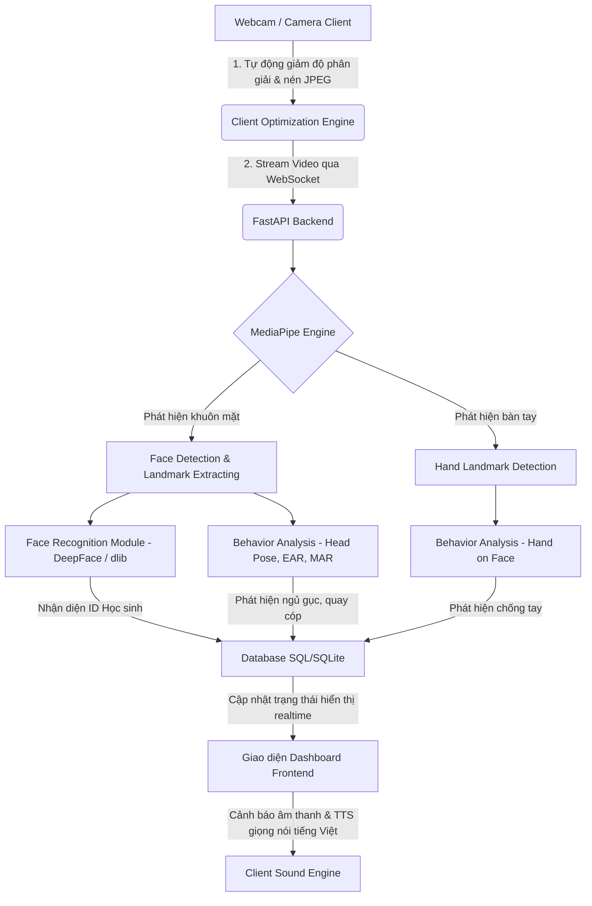

# Kế hoạch Triển khai Hệ thống Nhận diện Khuôn mặt & Giám sát Lớp học (Face Recognition & Classroom Monitoring)

Hệ thống quản lý lớp học thông minh sử dụng camera (webcam) để điểm danh, nhận diện học sinh, chọn ngẫu nhiên học sinh trả bài (quản lý theo phiên) và tự động phát hiện các hành vi bất thường trong lớp học (ngủ gục, chống tay, quay cóp, trao đổi).

---

## 1. Kiến trúc Hệ thống (System Architecture)

Hệ thống được thiết kế dưới dạng **Web Application** chạy trên nền tảng Python ở Backend và giao diện Web hiện đại ở Frontend.



### Công nghệ sử dụng:
*   **Backend**: Python (FastAPI), OpenCV, MediaPipe, SQLite (SQLAlchemy).
*   **Frontend**: HTML5, CSS (Vanilla CSS với phong cách Glassmorphism, Dark Mode, Responsive Grid), Javascript (WebSocket Client, Chart.js để vẽ biểu đồ thống kê).
*   **Tối ưu hóa Truyền tải & AI**: 
    - **Adaptive Downscaling**: Client tự động điều chỉnh độ phân giải về chiều rộng tối đa `640px` (giữ nguyên tỷ lệ) và đặt chất lượng JPEG nén ở mức `70%` trước khi gửi qua WebSocket. Giúp giảm tải mạng ~80% và tiết kiệm 50% CPU xử lý của server.
    - **Audio & TTS Engine**: Phát cảnh báo âm thanh bíp kép (Web Audio API) và thông báo giọng nói tiếng Việt (Web Speech API) trực tiếp trên trình duyệt với cơ chế cooldown 10 giây để tránh chồng chéo tiếng ồn.
*   **Thư viện chính**:
    *   `mediapipe`: Trích xuất Face Mesh (468+ điểm mốc khuôn mặt) và Hand Landmarks (21 điểm mốc bàn tay).
    *   `face_recognition` hoặc `DeepFace`: Trích xuất đặc trưng khuôn mặt (128-D vector) để so khớp danh tính học sinh.
    *   `numpy` & `scipy`: Xử lý hình học không gian, tính toán khoảng cách và các chỉ số hành vi.

---

## 2. Thiết kế Cơ sở Dữ liệu (Database Design)

Sử dụng SQLite để lưu trữ thông tin nội bộ đơn giản và hiệu quả.

### Bảng `students` (Danh sách học sinh)
| Trường | Kiểu dữ liệu | Mô tả |
| :--- | :--- | :--- |
| `id` | INTEGER (PK) | Khóa chính |
| `student_code` | VARCHAR(20) | Mã số học sinh (duy nhất) |
| `fullname` | VARCHAR(100) | Họ và tên học sinh |
| `embedding` | TEXT / BLOB | Vector đặc trưng khuôn mặt dạng JSON string hoặc nhị phân |
| `avatar_path` | VARCHAR(255) | Đường dẫn đến ảnh đại diện |

### Bảng `sessions` (Phiên học / Tiết học)
| Trường | Kiểu dữ liệu | Mô tả |
| :--- | :--- | :--- |
| `id` | INTEGER (PK) | Khóa chính |
| `created_at` | TIMESTAMP | Thời gian bắt đầu phiên |
| `status` | VARCHAR(10) | Trạng thái phiên (`ACTIVE`, `FINISHED`) |

### Bảng `session_students` (Trạng thái gọi tên trong phiên)
| Trường | Kiểu dữ liệu | Mô tả |
| :--- | :--- | :--- |
| `id` | INTEGER (PK) | Khóa chính |
| `session_id` | INTEGER (FK) | Liên kết với bảng `sessions` |
| `student_id` | INTEGER (FK) | Liên kết với bảng `students` |
| `is_present` | BOOLEAN | Xác nhận có mặt trong lớp học |
| `is_called` | BOOLEAN | Đã được gọi lên trả bài hay chưa |
| `called_at` | TIMESTAMP | Thời điểm bị gọi tên (nullable) |

### Bảng `behavior_logs` (Nhật ký hành vi)
| Trường | Kiểu dữ liệu | Mô tả |
| :--- | :--- | :--- |
| `id` | INTEGER (PK) | Khóa chính |
| `session_id` | INTEGER (FK) | Liên kết với bảng `sessions` |
| `student_id` | INTEGER (FK) | Liên kết với bảng `students` (nullable nếu không nhận diện được) |
| `behavior_type`| VARCHAR(20) | Loại hành vi (`SLEEPING`, `HAND_ON_FACE`, `CHEATING`, `TALKING`) |
| `timestamp` | TIMESTAMP | Thời điểm phát hiện hành vi |
| `snapshot_path`| VARCHAR(255) | Đường dẫn lưu ảnh chụp làm bằng chứng |

---

## 3. Thuật toán Phát hiện Hành vi & Logic Cảnh báo (Behavior Detection & Alert Logic)

Sử dụng **MediaPipe Face Mesh** (468 điểm mốc) và **MediaPipe Hands** (21 điểm mốc) để phân tích hành vi mà không cần chạy các mô hình Deep Learning quá nặng.

### 3.1. Phát hiện Ngủ gục (Sleeping)
*   **Phương pháp**: Tính toán tỉ lệ đóng mở mắt **EAR (Eye Aspect Ratio)** dựa trên các điểm mốc mắt của MediaPipe.
    $$EAR = \frac{||p_2 - p_6|| + ||p_3 - p_5||}{2 \times ||p_1 - p_4||}$$
    *(Trong đó $p_1 \dots p_6$ là tọa độ các điểm mốc trên mắt trái/phải).*
*   **Logic**: 
    1. Nếu $EAR < Threshold\_Eye$ (thường là 0.2) liên tục trong $N$ giây (ví dụ: 3 giây), hệ thống ghi nhận trạng thái **Nhắm mắt**.
    2. Kết hợp với **Độ nghiêng của đầu** (Pitch angle): Nếu góc Pitch nghiêng xuống dưới quá mức cho phép cùng lúc nhắm mắt, hệ thống xác nhận học sinh đang **Ngủ gục**.

### 3.2. Phát hiện Chống tay (Hand on Face)
*   **Phương pháp**: Sử dụng đồng thời **MediaPipe Face Mesh** và **MediaPipe Hand Landmarker**.
*   **Logic**:
    1. Lấy tọa độ vùng biên khuôn mặt (Face Boundary) hoặc các mốc ở cằm, má từ Face Mesh.
    2. Lấy tọa độ 21 điểm mốc của bàn tay (đặc biệt là các đầu ngón tay và lòng bàn tay).
    3. Tính toán khoảng cách Euclidean ngắn nhất giữa các điểm mốc tay và các điểm mốc mặt.
    4. Nếu khoảng cách giữa bất kỳ điểm mốc tay nào tới vùng mặt nhỏ hơn một khoảng $Threshold\_Hand$ (tương đối theo kích thước khuôn mặt) và kéo dài hơn 2 giây $\rightarrow$ Hệ thống cảnh báo hành vi **Chống tay lên cằm/má**.

### 3.3. Phát hiện Quay cóp / Nhìn xung quanh (Cheating / Looking Away)
*   **Phương pháp**: Ước lượng tư thế đầu **Head Pose Estimation** bằng thuật toán PnP (Perspective-n-Point) của OpenCV.
*   **Logic**:
    1. Chọn một tập hợp các điểm mốc 3D chính trên mặt (đầu mũi, cằm, góc mắt trái/phải, góc miệng trái/phải).
    2. So khớp các điểm mốc này với mô hình khuôn mặt 3D chuẩn (Generic 3D Face Model) để giải phương trình PnP, tìm ra ma trận quay (Rotation Matrix) và dịch chuyển.
    3. Tính ra các góc Euler: **Pitch** (ngẩng/cúi), **Yaw** (quay trái/phải), **Roll** (nghiêng trái/phải).
    4. Nếu góc **Yaw** lệch quá $\pm 30^\circ$ (quay đầu sang trái/phải) hoặc góc **Pitch** cúi xuống quá thấp (nhìn xuống gầm bàn) liên tục trong $T$ giây $\rightarrow$ Xác nhận hành vi **Quay cóp / Nhìn xung quanh**.

### 3.4. Phát hiện Trao đổi / Nói chuyện (Talking)
*   **Phương pháp**: Tính toán tỉ lệ mở miệng **MAR (Mouth Aspect Ratio)**.
*   **Logic**:
    1. Tính khoảng cách dọc giữa môi trên và môi dưới chia cho khoảng cách ngang giữa 2 khóe mép.
    2. Nếu giá trị MAR dao động lớn và liên tục đổi trạng thái mở/khép ở tần số nói chuyện thông thường trong khi tư thế đầu đang hướng về phía học sinh khác $\rightarrow$ Cảnh báo **Trao đổi bài**.

### 3.5. Cơ chế Cảnh báo thông minh phía Client
*   **Cảnh báo âm thanh (Audio alert)**: Sử dụng `AudioContext` của trình duyệt phát âm thanh bíp kép nốt A5 (880Hz) trong 0.2 giây.
*   **Giọng nói tiếng Việt (TTS)**: Sử dụng Web Speech API với cấu hình `vi-VN` để phát âm thông báo: *"Cảnh báo [Tên hành vi], [Tên học sinh]"*.
*   **Hạn chế tiếng ồn (Alert Cooldown)**: Triển khai bộ nhớ đệm Cooldown 10 giây trên trình duyệt cho mỗi cặp (Hành vi + Học sinh) để tránh phát âm thanh trùng lặp liên tục khi học sinh duy trì vi phạm.

---

## 4. Các chức năng Quản lý Học sinh & Phiên học (Student & Session Management)

### 4.1. Chọn ngẫu nhiên học sinh trả bài (Random Student Picker)
1.  **Thiết lập phiên**: Giáo viên bắt đầu một phiên học (Session). Hệ thống sẽ tự động nhận diện tất cả các khuôn mặt hiện diện trong khung hình camera để đánh dấu chuyên cần (`is_present = True`).
2.  **Bộ lọc danh sách gọi**: Khi giáo viên nhấn nút **"Gọi ngẫu nhiên"**, hệ thống sẽ thực hiện truy vấn:
    ```sql
    SELECT * FROM session_students 
    WHERE session_id = :active_session_id 
      AND is_present = True 
      AND is_called = False;
    ```
3.  **Thuật toán lựa chọn**: 
    *   Hệ thống chọn ngẫu nhiên một học sinh từ danh sách trên.
    *   Cập nhật `is_called = True` và thời gian gọi `called_at`.
    *   Nếu danh sách trống (tất cả học sinh có mặt đều đã được gọi), hệ thống sẽ hiển thị thông báo và cung cấp tùy chọn **Reset phiên gọi** (đặt toàn bộ `is_called = False` để bắt đầu vòng mới).
4.  **Hiệu ứng Giao diện**: Hiển thị vòng quay và xáo trộn tên ngẫu nhiên có kèm ảnh đại diện trước khi dừng lại để tăng tương tác sinh động.

---

## 5. Các bước Triển khai Chi tiết (Step-by-Step Implementation Plan)

### Bước 1: Thiết lập môi trường và cấu trúc thư mục
1. Khởi tạo môi trường ảo Python: `python -m venv venv`.
2. Cài đặt các thư viện phụ thuộc: `pip install -r requirements.txt` và `pip install -r requirements-ai.txt` (DeepFace, TensorFlow, tf-keras).
3. Toàn bộ mã nguồn Python, cấu hình cơ sở dữ liệu, static assets (CSS, JS) và HTML template được đặt tập trung trong thư mục `src/`.

### Bước 2: Xây dựng Cơ sở Dữ liệu & Đăng ký Học sinh
1. Viết `database.py` và `models.py` kết nối cơ sở dữ liệu SQLite qua SQLAlchemy ORM.
2. Xây dựng API `/api/students/register` trích xuất vector đặc trưng khuôn mặt (embeddings) bằng `DeepFace.represent()` và mã hóa ảnh avatar để lưu trữ bảo mật.

### Bước 3: Phát triển Core AI Nhận diện & Phân tích hành vi
1. Xây dựng `behavior_engine.py` tính toán các góc tư thế đầu (solvePnP), EAR cho mắt, MAR cho miệng và khoảng cách bàn tay tới mặt.
2. Xây dựng `face_engine.py` nhận diện khuôn mặt bằng DeepFace định kỳ mỗi 1.5 giây. Các frame ở giữa duy trì danh tính bằng Face Mesh ID để tiết kiệm tài nguyên.

### Bước 4: WebSocket Server và tối ưu hóa xử lý video
1. WebSocket Endpoint `/ws` nhận frame video đã được **Adaptive Downscaled** về chiều rộng tối đa 640px và chất lượng JPEG 70% từ Frontend.
2. Chạy hàm xử lý nhận diện khuôn mặt và hành vi trên thread pool (`asyncio.to_thread`) tránh gây block event loop.
3. Sử dụng Pillow và font chữ hệ thống `Arial.ttf` để vẽ đè nhãn tiếng Việt Unicode lên ảnh và trả về cho client. Hỗ trợ fallback về `cv2.putText` nếu Pillow gặp sự cố.

### Bước 5: Thiết kế Giao diện Dashboard & Cảnh báo âm thanh
1. Xây dựng layout Glassmorphism Dark/Light mode trong [index.html](file:///Users/quocthang0507/GitHub/face-recognition/src/templates/index.html) và [style.css](file:///Users/quocthang0507/GitHub/face-recognition/src/static/css/style.css).
2. Viết logic Client-side trong [app.js](file:///Users/quocthang0507/GitHub/face-recognition/src/static/js/app.js) để:
   - Thu thập luồng camera và vẽ thu nhỏ trên canvas gửi lên server.
   - Xử lý bật/tắt camera nóng (Hot-swapping) thông qua dropdown chọn nguồn.
   - Nhận kết quả và cập nhật giao diện, phát cảnh báo tiếng bíp kép và đọc tên bằng tiếng Việt với cooldown hạn chế tiếng ồn 10 giây.
   - Quản lý trạng thái các checkbox và đồng bộ hóa qua `localStorage`.

---

## 6. Tiêu chuẩn Nghiệp vụ, Code sạch & Bảo mật (Standards, Clean Code & Security)

### 6.1. Tiêu chuẩn Nghiệp vụ & Độ tin cậy (Business & Quality Standards)
*   **Độ tin cậy điểm danh**: Đánh dấu có mặt (`is_present = True`) khi hệ thống nhận diện thành công với độ tin cậy tối thiểu 80% trong 5 frame liên tiếp để tránh nhận dạng sai do nhòe hình.
*   **Ảnh bằng chứng (Audit Trail)**: Mọi hành vi vi phạm lớp học được ghi nhận đều đi kèm với một ảnh chụp bằng chứng (`snapshot_path`) giúp giáo viên đối chiếu trực quan.
*   **Hiệu năng Real-time**: Đạt 15-20 FPS ở client nhờ kỹ thuật Client Downscaling (640px) và tối ưu hóa phân tách luồng nhận diện khuôn mặt của Backend.

### 6.2. Tiêu chuẩn Code sạch Quốc tế (Clean Code Standards)
*   **Quy ước định dạng code**: Tuân thủ quy chuẩn **PEP 8** của Python (`black` và `flake8`).
*   **Nguyên lý SOLID**: Phân tách SRP (Single Responsibility Principle) giữa các module xử lý (`behavior_engine.py` chỉ phân tích hình học, `face_engine.py` chỉ nhận diện, `models.py` định nghĩa bảng).

### 6.3. Bảo mật & An toàn Dữ liệu (Security & Data Protection)
*   **Bảo vệ dữ liệu cá nhân**: Tuân thủ **Nghị định 13/2023/NĐ-CP** và **GDPR**. Không lưu trữ hình ảnh khuôn mặt thô của học sinh, chỉ lưu trữ đặc trưng khuôn mặt dưới dạng vector embeddings số học không thể giải mã ngược.
*   **An toàn truyền tải**: Sử dụng giao thức HTTPS và WSS (WebSocket Secure) cho môi trường Production.
*   **Bảo mật Database**: Sử dụng SQLAlchemy ORM ngăn chặn tấn công SQL Injection.
*   **Dọn dẹp định kỳ**: Tác vụ nền (FastAPI lifespan) chạy định kỳ mỗi 24 giờ để tự động xóa các log vi phạm và ảnh bằng chứng cũ hơn 30 ngày.

---

## 7. Kế hoạch Nghiệm thu & Kiểm thử (Verification Plan)

### Kiểm thử Tự động (Automated Testing)
*   Sử dụng `pytest` để viết unit test cho các module tính toán hình học, nghiệp vụ cơ sở dữ liệu, quản lý token, và xử lý lệnh WebSocket.

### Kiểm thử Thủ công (Manual Verification)
1. Đăng ký dữ liệu học sinh mẫu.
2. Kiểm tra nhận dạng khuôn mặt và điểm danh chính xác khi học sinh ngồi trước webcam.
3. Bấm gọi ngẫu nhiên nhiều lần để kiểm tra logic chọn học sinh và reset lượt gọi.
4. Mô phỏng các hành vi nhắm mắt ngủ gục, chống cằm, quay đầu để kiểm tra:
   - Hiển thị bounding box và nhãn tiếng Việt trên video.
   - Cảnh báo âm thanh bíp và TTS tiếng Việt đọc to tên học sinh.
   - Cơ chế cooldown 10 giây chặn âm thanh lặp lại dồn dập.

---

## 8. Các Cải tiến & Tối ưu đã Thực hiện (Implemented Enhancements)

*   **Việt hóa Giao diện Hoàn toàn (Full Localization)**: Bản địa hóa 100% giao diện, thông báo lỗi, nhật ký hành vi và phản hồi từ API/WebSocket sang tiếng Việt.
*   **Vẽ tiếng Việt Unicode trên Video overlay (PIL & TTF Fonts)**: Sử dụng Pillow kết hợp font chữ hệ thống `Arial.ttf` để hiển thị tiếng Việt Unicode không bị vỡ chữ trên video overlay.
*   **Cơ chế Tự động Dự phòng (Safety Fallback)**: Tự động fallback về dùng `cv2.putText` nguyên bản nếu PIL gặp lỗi để tránh treo hoặc đen luồng video.
*   **Khởi động Camera tức thời (Instant Video Preview)**: Điều chỉnh thuộc tính CSS opacity giúp hiển thị video webcam lập tức ngay khi bấm nút mở camera.
*   **Tải trước mô hình AI (Lifespan Preloading)**: Tải trước mô hình DeepFace và MediaPipe khi FastAPI khởi chạy (lifespan), triệt tiêu hoàn toàn độ trễ 10s của frame đầu tiên.
*   **Chọn nguồn camera nóng (Hot-swapping Camera)**: Tích hợp dropdown thiết bị cho phép giáo viên chuyển đổi trực tiếp giữa các webcam thời gian thực mà không cần tải lại trang.
*   **Khắc phục lỗi ngắt kết nối WebSocket (ASGI RuntimeError)**: Bổ sung bước kiểm tra loại thông điệp `websocket.disconnect` trong luồng xử lý của FastAPI để giải phóng tài nguyên sạch sẽ khi đóng socket.
*   **Đồng nhất và Cài đặt thư viện AI**: Cài đặt gói `tf-keras` và đồng nhất các dependencies của tensorflow, protobuf giúp hệ thống hoạt động ổn định.
*   **Thêm favicon chất lượng cao** đồng bộ với giao diện Dashboard của hệ thống.
*   **Tự động giảm độ phân giải phía Client (Adaptive Downscaling)**: Tự động nén và thu nhỏ ảnh về chiều rộng tối đa 640px (JPEG 70%) ở Client, tiết kiệm ~80% băng thông truyền tải và giảm 50% CPU xử lý của máy chủ.
*   **Cảnh báo âm thanh & Giọng nói tiếng Việt (Audio & TTS Warnings)**:
    - Bổ sung tùy chọn phát tiếng bíp kép cảnh báo vi phạm sử dụng Web Audio API (chạy offline).
    - Đọc to cảnh báo bằng giọng nói tiếng Việt bằng Web Speech API (`SpeechSynthesis`).
    - Tích hợp checkboxes điều khiển bật/tắt và đồng bộ hóa qua `localStorage`.
    - Thiết lập cơ chế **Alert Cooldown (10 giây)** cho mỗi học sinh và loại vi phạm để tránh gây tiếng ồn chồng chéo.
*   **Điều chỉnh tần suất truyền hình ảnh (Dynamic Client FPS Selection)**:
    - Bổ sung dropdown menu `#video-fps-select-modal` cho phép cấu hình tần suất gửi frame từ client (15 FPS / 10 FPS / 5 FPS / 2 FPS) và lưu thiết lập vào `localStorage`.
    - Tiết kiệm tương ứng 50% hoặc 80% CPU xử lý AI của server và băng thông mạng, trong khi vẫn đảm bảo độ chính xác tuyệt đối của các thuật toán phát hiện hành vi nhờ cơ chế tính thời gian trôi qua thực tế (`time.monotonic()`) thay vì đếm số frame.
*   **Hộp thoại Cài đặt Tập trung (Settings Modal)**:
    - Hợp nhất tất cả các tùy chọn cấu hình nâng cao bao gồm: đổi nguồn camera, tần suất gửi ảnh (FPS), theme sáng/tối, tùy chọn âm thanh/giọng nói, và bộ chọn giọng đọc (TTS Voice Selector) của hệ thống vào một hộp thoại popup (#settings-modal) duy nhất.
    - Giúp làm gọn gàng giao diện chính của Dashboard, cho phép giáo viên tùy chọn giọng đọc phù hợp dựa trên danh sách giọng đọc tiếng Việt/hệ thống có sẵn.

---

## 9. Đề xuất Tính năng Nâng cấp trong Tương lai (Future Feature Proposals)

*   **Xuất Báo cáo Điểm danh & Hành vi (Report Exporting)**: API kết xuất chuyên cần và nhật ký hành vi vi phạm ra file Excel (.xlsx) hoặc CSV khi kết thúc phiên.
*   **Biểu đồ Thống kê Trực quan (Behavior Analytics Chart)**: Sử dụng Chart.js trên Frontend hiển thị biểu đồ tròn về tỷ lệ tập trung của lớp và biểu đồ đường thể hiện tần suất hành vi vi phạm theo thời gian tiết học.
*   **Tối ưu hóa GPU (Metal/CUDA Acceleration)**: Biên dịch OpenCV và TensorFlow với CUDA (NVIDIA) hoặc MPS (Apple Silicon macOS) để tăng tối đa FPS xử lý.
*   **Tích hợp Chế độ Chạy Ngoại tuyến (Offline Caching)**: Lưu trữ các tệp trọng số mô hình (weights) của DeepFace trực tiếp trong dự án để hoạt động không cần Internet trong lần đầu khởi chạy.
*   **Quản lý Danh sách Lớp học (Class/Subject Management)**: Hỗ trợ cấu hình danh sách học sinh riêng biệt theo từng lớp và môn học khác nhau.
